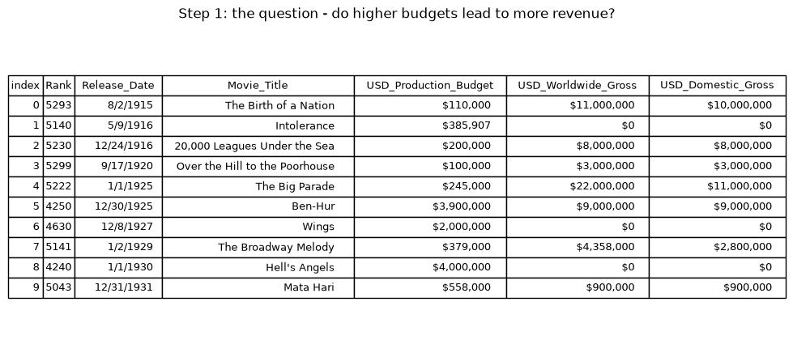
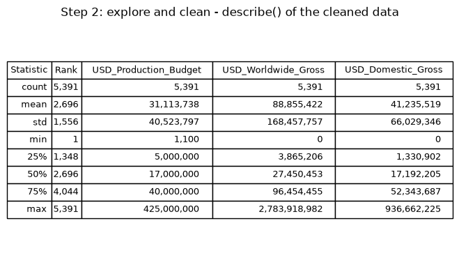
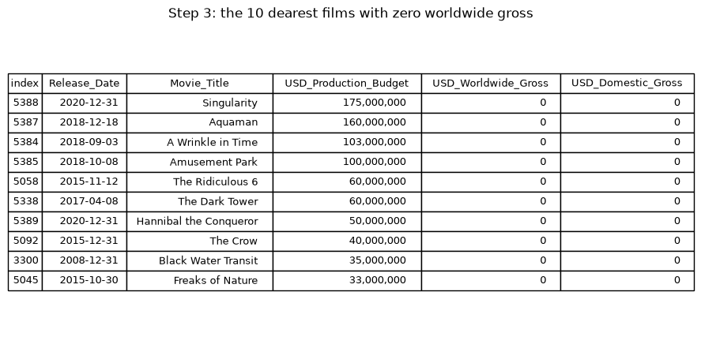
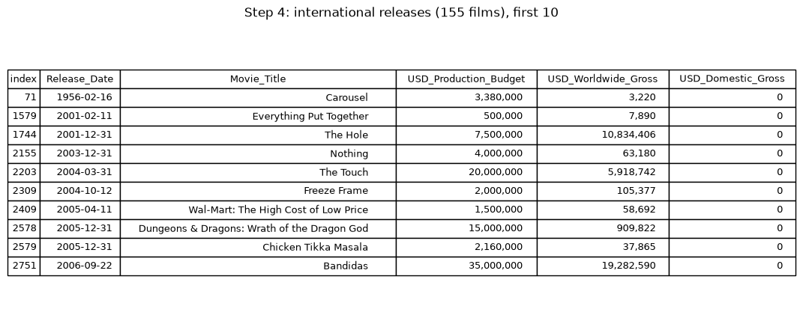
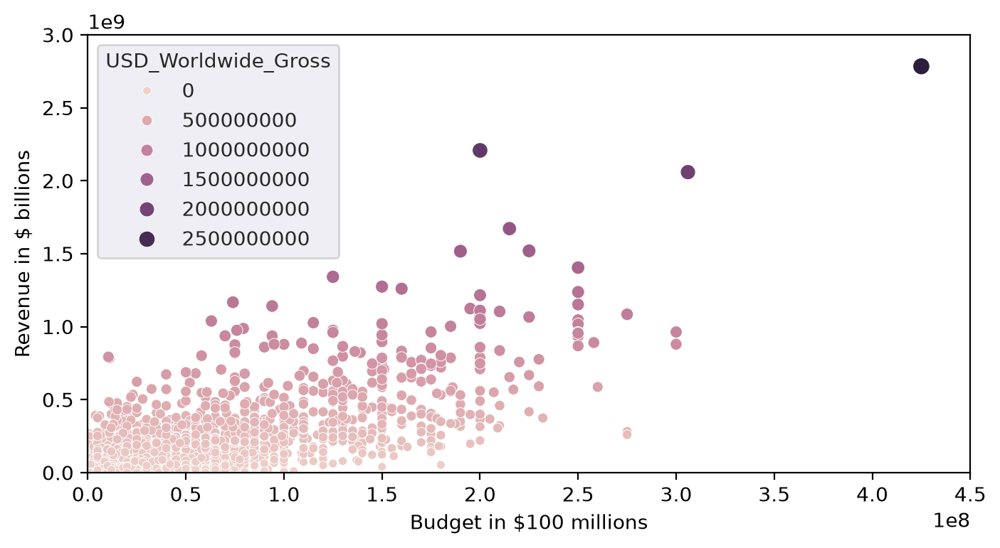
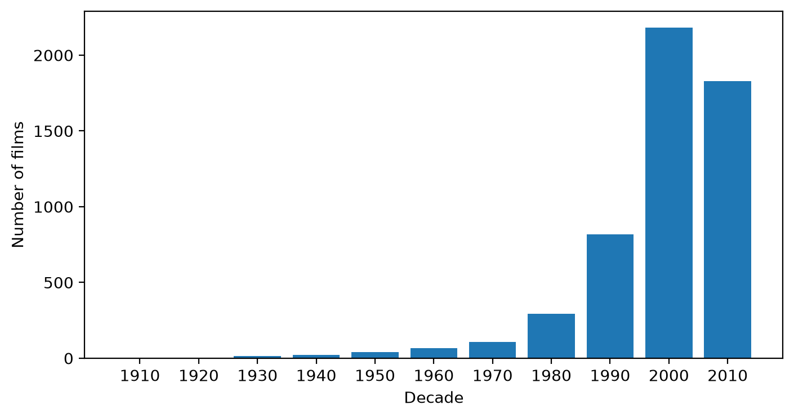
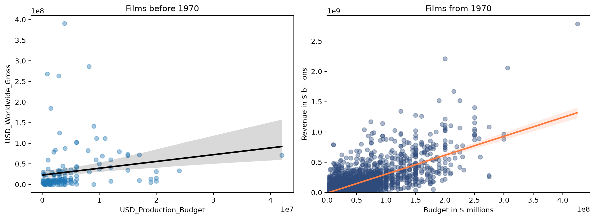
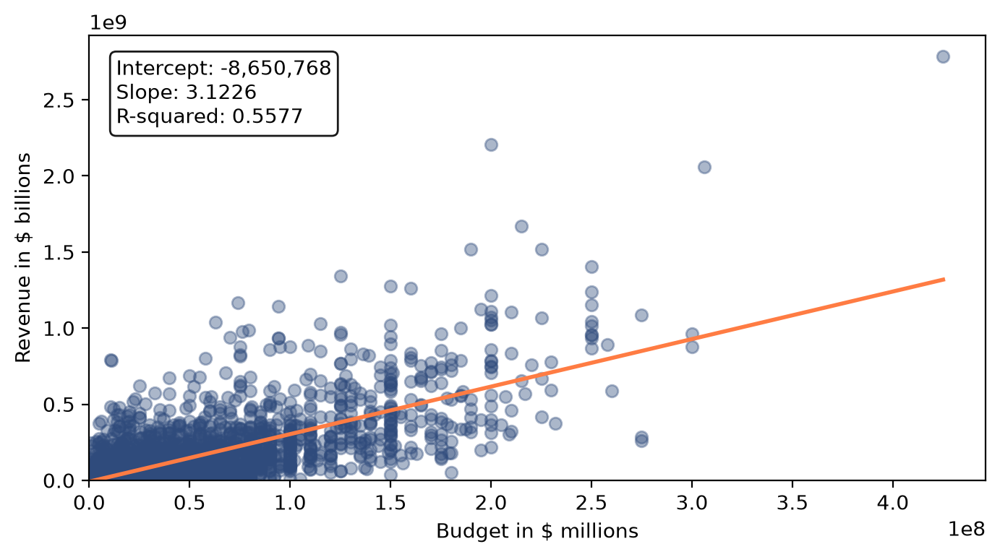
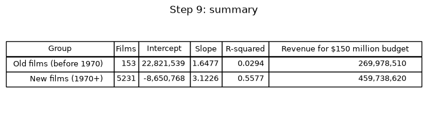

# 🚀 078 Seaborn and Linear Regression

Day 78 of Udemy's *100 Days of Code: The Complete Python Pro Bootcamp*: do higher film budgets lead to more box office revenue? The project cleans a movie budget and revenue dataset, draws Seaborn charts and runs a linear regression with scikit-learn. It is for course participants who want runnable, tested code and for anyone browsing for ideas.

## 📚 Table of Contents

- [Overview](#-overview)
- [Requirements](#-requirements)
- [Setup](#-setup)
- [Run](#-run)
- [Tests](#-tests)
- [License](#-license)
- [Links](#-links)
- [Appendix: Project documents](#-appendix-project-documents)

## 🧭 Overview

| Folder | What it holds |
| --- | --- |
| `src/movie_regression/` | The analysis package |
| `tests/` | Tests that assert the values of the dataset |
| `data/` | `cost_revenue_dirty.csv`, the film budget and revenue dataset supplied with the lecture (it belongs to the course material) |
| `notebooks/` | The Jupyter notebook that follows the nine lecture steps |
| `docs/` | Project documents, the screenshots (`docs/images/`) and the wiki sources (`docs/wiki/`: English, Danish, Bahasa Malaysia) |
| `scripts/` | `scan.sh` (opengrep), `make_screenshots.py` and the notebook generator |

The question of the day: do higher film budgets lead to more revenue at the box office? The answer is a regression of the worldwide gross on the production budget: weak for films before 1970 (R-squared 0.03), decent for films from 1970 (R-squared 0.56).

### 🖼️ Lecture steps

One screenshot per lecture step, generated from the code with `python scripts/make_screenshots.py`. The [wiki][wiki] (English, Dansk, Bahasa Malaysia) explains what each step teaches and has a Getting Started guide for Windows and Linux.

**Step 1: The goals (the question and the raw data)**



**Step 2: Explore and clean the data**



**Step 3: Films with zero revenue**



**Step 4: International releases, filtered on multiple conditions**



**Step 5: A Seaborn bubble chart**



**Step 6: Floor division turns years into decades**



**Step 7: Regression plots, old films and new films**



**Step 8: A regression with scikit-learn**



**Step 9: Learning points and summary**



## 📋 Requirements

- Python 3.13 or newer, to run the code.
- `pandas`, `matplotlib`, `seaborn` and `scikit-learn`, the only runtime dependencies; they are installed by the setup below.
- `pytest`, `ruff`, `mypy`, `pandas-stubs` and Jupyter, only for development; installed with the `dev` extra.

## 🛠️ Setup

Create and use a local virtual environment named `.venv`.

Windows (PowerShell):

```powershell
python -m venv .venv
.venv\Scripts\Activate.ps1
python -m pip install --upgrade pip
python -m pip install -e ".[dev]"
```

Linux and macOS:

```bash
python3 -m venv .venv
source .venv/bin/activate
python -m pip install --upgrade pip
python -m pip install -e ".[dev]"
```

Leave out `[dev]` if you only want to run the analysis.

## ▶️ Run

Print the answers of every lecture step (cleaning, zero-revenue films, international releases, decades and the regressions):

```bash
python -m movie_regression
```

Open the notebook:

```bash
jupyter lab notebooks/Seaborn_and_Linear_Regression.ipynb
```

Regenerate the screenshots:

```bash
python scripts/make_screenshots.py
```

## 🧪 Tests

```bash
python -m pytest
```

Check the types (mypy in strict mode) and the style:

```bash
python -m mypy
python -m ruff check .
```

Before pushing, scan the code with opengrep (default path `~/.opengrep/cli/latest/opengrep.exe`):

```bash
bash scripts/scan.sh
```

## 📄 License

GNU Affero General Public License v3.0, see [LICENSE][license].

## 🔗 Links

- [Repository][repository]
- [Documentation][documentation]
- [Issue tracker][issues]

## 📎 Appendix: Project documents

The documents a newcomer needs, in reading order.

| Document | What it tells you |
| --- | --- |
| [AGENTS.md][agents] | The rules AI agents follow in this repository |
| [Business Case][BC-001] | Why the project exists, its scope and success criteria |
| [Stakeholder Analysis][SA-001] | Who is involved; the stakeholder IDs used for owners and reviewers |
| [Project Plan][PP-001] | The gateways and their schedule |
| [Milestones][milestones] | One document per gateway: Go/No-Go criteria and tasks |
| [Artifact registry][registry] | Where each artifact type lives, the next version, the PO language and domain |
| [Wiki sources][wikisrc] | The lecture steps explained in English, Danish and Bahasa Malaysia |
| [Traceability matrix][TM-001] | How the artifacts link and when each was last reviewed |
| [Framework README][framework-readme] | The framework this project uses |
| [Framework changelog][framework-changelog] | What changed in each framework release |

---

[wiki]: https://git.tirsystem.com/Tirsvad-Udemy-100-days-of-code/078-Seaborn-and-Linear-Regression/wiki
[license]: ./LICENSE
[repository]: https://git.tirsystem.com/Tirsvad-Udemy-100-days-of-code/078-Seaborn-and-Linear-Regression
[documentation]: https://git.tirsystem.com/Tirsvad-Udemy-100-days-of-code/078-Seaborn-and-Linear-Regression/wiki
[issues]: https://git.tirsystem.com/Tirsvad-Udemy-100-days-of-code/078-Seaborn-and-Linear-Regression/issues
[agents]: ./AGENTS.md
[BC-001]: ./docs/business-case.md
[SA-001]: ./docs/stakeholder-analysis.md
[PP-001]: ./docs/project-plan.md
[milestones]: ./docs/milestones/
[registry]: ./docs/artifact-registry.md
[wikisrc]: ./docs/wiki/Home.md
[TM-001]: ./docs/sqa/traceability-matrix.md
[framework-readme]: ./framework/README.md
[framework-changelog]: ./framework/CHANGELOG.md
